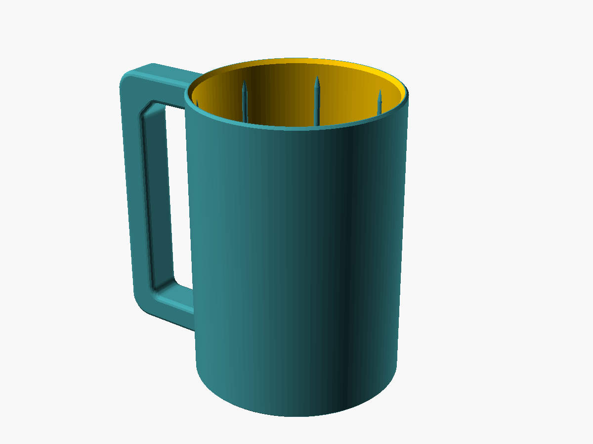
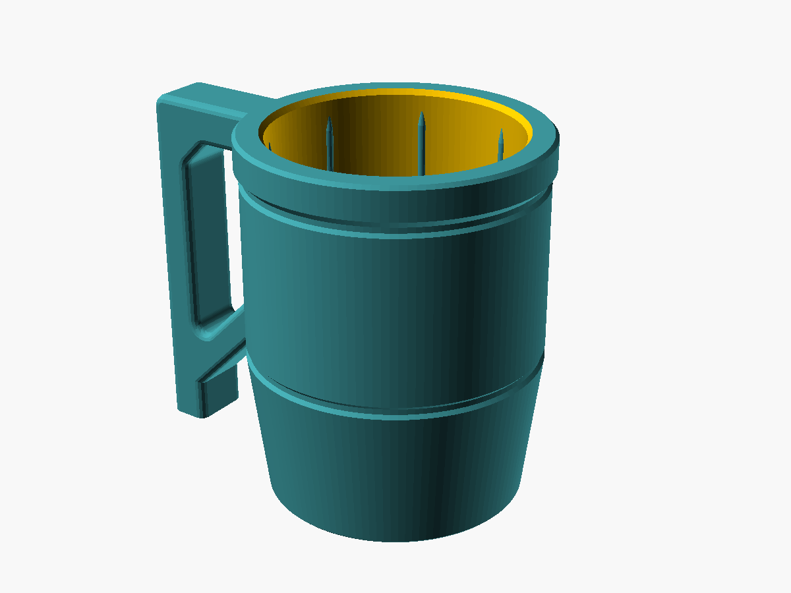
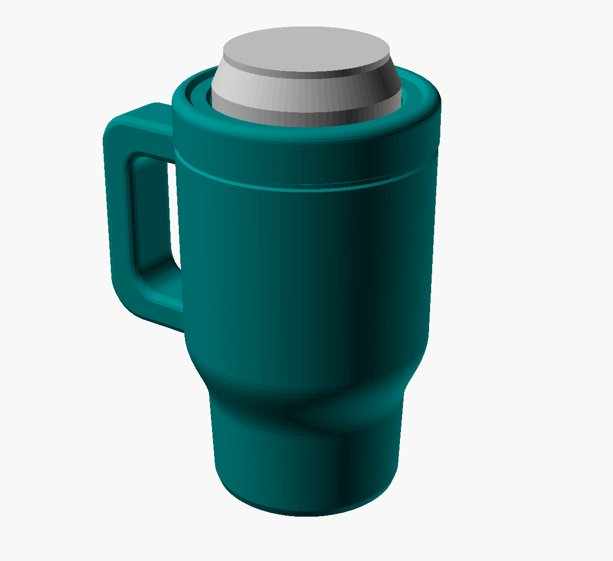

# Dosenhalter mit Henkel

Becher, der die Dose rundum umschliesst, mit seitlichem Henkel. Oben bleiben 15 mm frei, damit man aus der Dose trinken kann.

| Datei | Dose | Becher (Ø aussen × Höhe) |
|---|---|---|
| `dosenhalter_330.stl` | 330 ml Standard (Ø 66,2 × 115 mm) | 72,2 × 102 mm |
| `dosenhalter_500.stl` | 500 ml (Ø 66,2 × 168 mm) | 72,2 × 155 mm |
| `dosenhalter_250slim.stl` | 250 ml Slim (Ø 53 × 134 mm) | 59 × 121 mm |

## Druck
- Aufrecht drucken, Boden aufs Bett, **keine Stützen** nötig (der obere Henkelarm ist eine kurze Brücke, die Innenecke oben ist 45° angefast).
- 0,2 mm Schichthöhe, 3 Wände, 15–20 % Infill. PETG oder PLA.

## Passung
- Die 8 Klemmrippen innen halten die Dose. Sitzt sie zu locker oder zu stramm: in `dosenhalter.scad` den Wert `rippen_tiefe` ändern (Standard 0,7 mm).
- Durch das Loch im Boden kann man die leere Dose herausdrücken.

## Anpassen
`dosenhalter.scad` in OpenSCAD öffnen. Im Customizer kann man Dosentyp, eigene Masse, Wandstärke und Henkelgrösse einstellen. Danach F6 drücken und als STL exportieren.

## Variante: Tumbler-Stil (`tumbler.scad`)

Kleiner Trinkbecher-Look: unten verjüngt (passt in Auto-Getränkehalter), zwei Zierrillen, breiter Deckelring oben und ein kräftiger Henkel, dessen Fuss auf dem Druckbett steht. Dose, Klemmrippen und Bodenloch wie oben.

| Datei | Dose | Ø unten / oben × Höhe |
|---|---|---|
| `tumbler_330.stl` | 330 ml | 71 / 84 × 102 mm |
| `tumbler_500.stl` | 500 ml | 71 / 84 × 155 mm |
| `tumbler_250slim.stl` | 250 ml Slim | 58 / 71 × 121 mm |

Druck wie oben: aufrecht, ohne Stützen. Im Customizer lassen sich unter anderem `bauch` (wie viel breiter der Becher oben ist), `konus_h` und `ring_h` einstellen.

## Variante: Quencher-Form (`quencher.scad`)

Die Form des bekannten Trinkbechers mit Henkel, verkleinert, sodass eine Dose hineinpasst: schmaler Fuss, weicher Übergang zum breiten Oberteil, Deckelring mit Fuge und erhöhtem Rand, grosser Henkel. Die Dose schaut oben 12 mm heraus, damit man trinken kann (oder mit Strohhalm).

| Datei | Dose | Ø Fuss / oben × Höhe |
|---|---|---|
| `quencher_redbull250.stl` | Red Bull 250 ml (Ø 53 × 134 mm) | 58 / 75 × 124 mm |
| `quencher_330.stl` | 330 ml Standard | 71 / 92 × 105 mm |

**Druck:** aufrecht. Der untere Henkelarm hängt in der Luft und braucht **Stützen** (im Slicer „Stützen nur auf dem Druckbett“ bzw. Baumstützen). Der Rest druckt ohne. Im Customizer lassen sich Proportionen (`verhaeltnis`, Übergangshöhe) und der Henkel anpassen.
